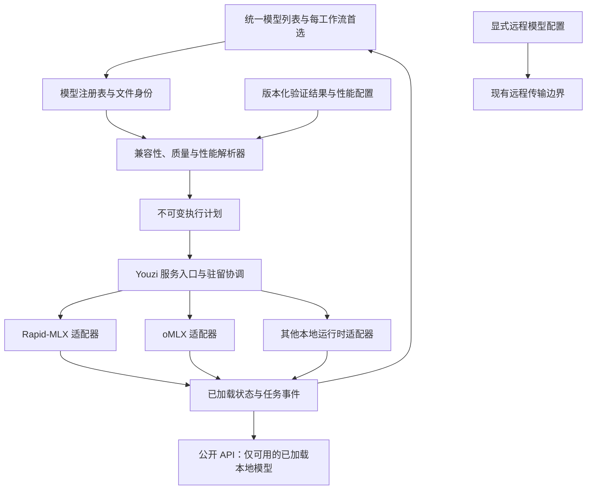

# Youzi 多运行时接入与性能选优提案

状态：**提议，尚未实施或批准切换默认运行时**。资料核查日期：2026-10-20。

负责人：Atlas；性能验证：Vector；界面协作：Pixel；打包与回退：Harbor。
本次在 Local Mac 的独立文档分支完成资料核查，不安装引擎、不下载权重、不运行推理，
也不改动 0.14.6 的修复、依赖或发布流程。所有性能优先级都是待验证的工程建议。

## 建议

方案可行。Youzi 应负责模型目录、偏好、权限、驻留状态、任务和对外协议，
把 Rapid-MLX 保留为默认推理后端，再按明确的兼容性契约接入其他运行时。
用户仍从一个模型列表选择模型；“用哪个引擎执行”是该模型的高级设置，
不应出现一套 Rapid-MLX 模型页面、一套 oMLX 页面和另一套 Ollama 页面。

先用 **Rapid-MLX 与 oMLX 的相同 MLX 文件**验证适配边界和性能差异。
原生 mlx-lm / mlx-vlm 用作定位服务开销的参考；llama.cpp 用作第二种文件格式的验证。
vLLM Metal 和 Splash 值得针对 Qwen3.8-27B 单独评估。
Ollama 优先接入用户已有服务；exo 留在确有多机需求时评估。
这些顺序依据接入范围和验证成本，不是速度排名。

当前没有本次任务产生的同机、同文件对照结果，不能认定 oMLX、Rapid-MLX 或任何其他
候选“最快”。应推荐“在这台机器、这个模型文件和这类任务上，经验证更合适的运行时”，
而不是给项目名称排一个永久榜单。

## 沿用现有产品边界

本提案扩展已有的[模型管理与性能事实分离](2026-08-22-model-management-performance-ssot.md)
和[原子模型目录](2026-08-31-atomic-product-model-catalog.md)，不另建注册表。
[当前架构清单](../architecture/model-management/architecture.yaml)仍有 partial / planned 项，
不能把这些设计实体描述成已经交付的完整系统。

以本次基线 `7992b7611342c283aea8bbc8d32abd9c35afa466` 为准，必须保留：

- **每种工作流只有一个 GUI 首选模型**，本地与远程共享选择入口；ASR 与 TTS 分开。
  当前 [`RemoteModelDocument.preferredModels`](../../../apps/rapid-mac/Sources/Rapid/RemoteModels/RemoteModelConfiguration.swift)
  与 [`YouziResidentService`](../../../apps/rapid-mac/Sources/Rapid/Server/YouziResidentService.swift)
  已实现这一规则。只有首选的本地模型可以自动加载；已经手动加载的其他模型继续可用。
  较早的[加载策略文档](youzi-model-selection-and-startup.md)中的有序池须结合
  [统一偏好交接](../../../.agents/handoffs/atlas-youzi-unified-models.md)阅读，不能借本提案恢复第二套默认值。
- 显式模型选择保持精确。首选为空或不可用，不意味着可以选择另一个模型、量化版本或云服务。
  改变首选不立即卸载已有模型，推荐也不授予加载和下载权限。
- 对外 [`/v1/models`](2026-09-06-youzi-loaded-model-discovery.md) 只列出实际已加载、
  可路由的本地模型，保留现有基础字段和扩展元数据。模型文件目录、第三方的 available
  列表、健康进程、已保存配置，都不等于“已加载”。
- [远程模型边界](2026-09-09-youzi-remote-models.md)不因换引擎而改变：不跨提供方重试，
  不把本地失败请求自动发往云端，不把远程配置纳入本地公开模型列表。
  远程密钥继续遵循[当前设置存储决定](2026-10-20-youzi-remote-settings-keys.md)；
  不在本提案中恢复旧钥匙串方案。
- [同一个应用运行状态图](2026-09-02-youzi-unified-product-runtime.md)继续服务所有界面。
  增加受控子进程不应产生第二套任务、聊天、下载或偏好仓库。

## 候选比较

下表只区分官方文档或源码已经说明的能力，以及还需 Youzi 实测的接入条件。
“支持图像理解”与“生成图片”不同，“视频输入”也不代表视频生成。
所有候选的具体模型、工具格式、取消和驻留语义均须重新验收。

| 候选 | 已核实的能力与 Apple Silicon 路径 | 文件与接入方式 | 对 Youzi 的判断 |
| --- | --- | --- | --- |
| Rapid-MLX | 本仓库通过 MLX 系列后端提供文本、多模态与媒体服务；当前 GUI、公开 API 和模型生命周期已围绕它集成 | 现有 MLX 文件、别名和打包侧车；源码主许可证 Apache-2.0 | 保留默认和回退基线，先包成第一个适配器。已有性能记录不能自动外推到新版本。见[模型支持](../../reference/models.md)、[依赖](../../../pyproject.toml)、[许可](../../../LICENSE) |
| oMLX | MLX 文本/VLM、embedding/reranker，连续批处理、RAM/SSD KV 缓存；macOS 15+，Python 3.11–3.13。源码含 Responses，以及安装 mlx-audio 时启用的音频路由 | 有前台 `omlx serve` 和 headless 管理 API；支持显式 load/unload，但也有 LRU、TTL 等自身策略。Apache-2.0 | 首个外部服务候选。能否禁止越权自动加载和淘汰是准入条件；不能把它的模型列表直接透传。图像/视频生成不作全面支持承诺。[README][omlx]、[管理 API][omlx-admin]、[服务源码][omlx-server] |
| mlx-lm / mlx-vlm / mlx-audio | MLX 原生 Python 栈：分别面向文本、视觉/Omni、音频；均有生成接口或服务入口。mlx-vlm 明列 Qwen3.8 DFlash2 示例，mlx-audio 有语音合成/识别端点 | MLX 文件最容易复用；各包版本、可选依赖、服务能力不同，不能当成一个统一运行时。均为 MIT | 适合作为参考基线或专门工作流后端；若补齐模型池、权限和管理协议，维护成本可能接近维护新服务器。[LM][mlx-lm]、[VLM][mlx-vlm]、[Audio][mlx-audio] |
| llama.cpp | C/C++，Apple Silicon 的 Metal / Accelerate / ARM 优化；文本和已支持的多模态模型；HTTP 服务、流式聊天及工具格式支持 | GGUF 路径；支持独立服务器，也有多模型 router、显式禁用 autoload 和睡眠状态。MIT | 适合验证非 MLX 文件与跨平台扩展。Qwen3.8-27B 的指定 GGUF、视觉投影、模板和 MTP 组合仍需逐项实测；有相近架构代码不等于该组合已通过验收。[项目][llama]、[服务器][llama-server] |
| Ollama | Metal 加速；原生管理 API 和部分 OpenAI 兼容 API。官方 Qwen3.8 标签已同时包含 MLX、GGUF 量化及 MTP 变体，不能再视为只有一种计算后端 | Safetensors / GGUF 导入及自有清单、blob 管理；常驻服务，`keep_alive` 和内存调度管理驻留。MIT | 适合用户已有模型生态。先作为明确配置的外部服务，受 Youzi 管理前须证明文件映射、实际 runner 和驻留约束。标签相同不证明与 HF 文件相同。[硬件][ollama-gpu]、[兼容 API][ollama-openai]、[导入][ollama-import]、[Qwen 标签][ollama-qwen]、[源码][ollama] |
| vLLM Metal | vLLM 调度/API + MLX 模型层 + Metal 分页注意力；macOS 15+。支持表明确列 Qwen3.8-27B **8-bit** 示例，自动前缀缓存标为实验；多模态目前是有限视觉支持 | 独立 Python 服务；特定版本绑定 vLLM、MLX 和模型库，官方稳定安装提供预编译 wheel。Apache-2.0 | 并发和服务吞吐候选；不能从 8-bit 示例推断当前 4-bit-MTP 文件、视觉或缓存组合已经验证。[项目][vllm-metal]、[支持矩阵][vllm-models]、[安装][vllm-install] |
| Splash | 针对 Qwen3.8-27B 等模型的 Metal 引擎、DFlash2、缓存与并发；官方构建要求 M3+、macOS 26.4+。支持指定 MLX/GGUF 等格式及模型相关视觉输入 | 独立进程，可直接接入，也可作为 oMLX 外部引擎；首次默认运行会下载目标和草稿模型。Apache-2.0 | 与本题高度相关，列为专项候选。必须预先准备并固定全部组件，使用离线加载；不能隐式带入新草稿模型。硬件/系统门槛较高。[项目][splash] |
| exo | 以 MLX 和分布式通信组成多机集群，提供实例放置/管理与多个兼容 API；Mac GPU 路径。macOS app 要求 26.2+，安装流程涉及网络配置 | 独立集群服务，可指定只读模型目录和离线模式。Apache-2.0 | 用于单机装不下或确需多机并行的场景；本次“同一台 Mac 的 27B”对照不优先引入。Qwen3.8 指定文件和模态未在本任务验证。[项目][exo] |

### 从项目活跃度到可交付能力

核查时各项目均未标记 archived，且有近期源码或发布；这只说明值得跟进。
它们还没有经过 Youzi 的发布包、取消、崩溃恢复、模型状态和多模态验收。
项目自测或 README 的吞吐数字也不能替代同机对照。

首轮 oMLX 应只启用其自身 MLX 引擎。其[外部引擎文档][omlx-splash]已经展示了
“统一模型列表 + 独立 Splash 子进程”的可行实现，但不能据此认为两者行为相同。
基准身份必须区分 `omlx/native-mlx`、`omlx/splash` 与 `splash/direct`，并记录整条版本链。
同一份文档还说明 Splash 路径没有视频/音频输入，且与原生引擎的加速开关不同。

打包不能只复制 Python 主包。oMLX 的部分加速依赖编译内核；其他候选也可能包含
Metal 库、原生扩展、模型处理器或可选音频/结构化输出依赖。
使用独立、版本固定的运行时目录；禁止在 Rapid-MLX 已打包环境中升级依赖来“兼容所有引擎”。
许可证按本次读取的各项目 LICENSE 记录，发行还需核对实际依赖与模型文件的许可及通知；
运行时许可证不代表权重许可证。此处不承诺未经审查的再分发组合。

## 一个模型目录，分开记录文件与执行方式

建议在已有原子契约之上补齐适配边界：

| 实体 | 保存什么 | 不应该保存什么 |
| --- | --- | --- |
| `ModelRegistryRecord` / 产品别名 | 用户认识的模型、工作流、显示名、版本关系 | 运行时当前是否活着、一次测试的速度冠军 |
| `ModelIdentity` / `Artifact` | 固定仓库 revision、完整文件摘要、量化方案、tokenizer、模板、视觉/音频等组件 | 仅凭名称猜测的等价性；可变 `main` 冒充不可变身份 |
| 本地文件位置 | artifact 到本机目录/文件的映射、下载状态、引用关系 | 写入可上传原子身份的用户名或绝对路径 |
| `RuntimeAdapter` / 安装记录 | 版本、实际计算后端、协议、硬件要求、可观测管理能力、owned/attached | 用户首选模型或私自下载权限 |
| `RuntimeCompatibility` / qualification | artifact × 运行时版本 × 操作的硬约束和验收结果 | 从相近模型名复制的支持声明 |
| `PerformanceProfile` | 同一 artifact、机器类别、任务、运行时范围下已晋级的参数与证据 | 在 UI 中写死的全局“最快引擎” |
| 执行计划与 residency | 本次实际 artifact/runtime/profile、有效参数、进程 epoch、模型实例与请求租约 | 改变模型首选，或把已注册误作已加载 |

这些名称表示设计边界，不要求一次新建全部数据库。
优先复用 [`proto/model-runtime`](../../../proto/model-runtime/README.md)、
现有 catalog 和执行配置。现有 v1 schema 使用 `additionalProperties: false`；
确需新增原子字段时新建契约版本并提供迁移，不能静默扩展 v1。
完整性能来源可由独立运行记录关联 runtime digest，不必把运行时版本塞进权重身份。

用户看到的主行可以是“Qwen3.8 27B · 4-bit”，详情展示已安装文件与可用引擎。
但 MLX affine 4-bit 和 GGUF Q4_K_M 必须是**可分辨的文件变体**，不可折叠成可任意替换的同一对象。
仅两个引擎读取同一 artifact 时，才可以让主行保持完全相同、仅改变执行方式。
高级项提供“自动（已验证）”和明确固定引擎，显示选择原因、适用任务及限制。
公开模型 ID 保持已有稳定语义，不把进程端口或版本拼入用户模型名；诊断记录补充执行身份。

公开入口仍由 Youzi 统一持有，第三方服务使用内部端口，不能各自向客户端暴露一套默认选择。
同一 artifact 在两个引擎中同时驻留时，公开别名只绑定一个明确的服务实例；
绑定更新不得改变已开始请求的执行计划。诊断可以展示两个实例，主列表不因此复制模型。

## 适配器需要兑现的契约

### 能力协商与参数

有效能力取“模型文件能力 ∩ 运行时能力 ∩ 适配器已验收能力 ∩ 当前安装可用能力”。
缺少证据就是未验证，不能把 `/models`、架构名或存在某个 endpoint 当作通过。
至少按下列操作协商，而非只有一个 `supports_multimodal`：

- 文本生成、图像理解、视频理解、语音识别、语音合成、图片生成/编辑、视频生成，
  以及 embedding/rerank 等独立操作。
- 流式内容、独立 reasoning、工具调用、并行工具、结构化输出、token 计数；
  上下文上限、附件预算、模板和媒体处理器。
- 取消的真实范围、进度粒度、可观测驻留、显式加载/卸载及并发容量。

明确参数映射：采样、思考开关/预算、停止 token、上下文、KV 精度、缓存、
MTP/草稿器、图像尺寸/裁切、视频取帧等。重要参数无法表达时拒绝或显示可审核的变更，
不得静默丢弃。模型文件自带能力只是上限；关闭视觉塔的文本 profile 不再宣称可以看图。
工具权限、执行与结果归属继续由 Youzi 持有；第三方服务内置 MCP、搜索或自动工具执行
默认不接入，防止同一个工具被两个执行层重复运行。

### 生命周期、取消与事件

契约至少包括 `probe / describe / prepare / load / unload / generate / cancel / observe`。
`prepare` 只验证或准备已授权的本地资源；下载是单独的显式操作。
推理调用绝不承担下载和冷加载。没有精确百分比时显示“加载中”，不伪造进度。

内部事件统一为排队、加载、prefill、内容增量、reasoning 增量、工具增量、
媒体块/产物、usage、结束和错误，并保留原始阶段的可测时间戳。
只对已验收路径承诺流式工具参数；上游在整轮结束后才解析工具时应如实声明。
媒体任务要带 job ID、artifact ID、provider/runtime epoch、拥有它的任务及内容类型。
音频保留原始语速、节奏、音高与句子完整性，不能用变速解决不同引擎的时长差异。

取消返回 `requested / acknowledged / completed` 等可区分状态，并说明是否真正停止计算。
客户端断流不等于 GPU 停止，也不等于删除视频作业。须测取消后排队、显存和资源租约释放，
并拒绝旧进程/旧任务迟到的结果。不能为了取消一个请求杀死其他任务共用的服务。
外部 API 的 Responses、Anthropic 等由 Youzi 保持现有语义；某候选仅有 Chat Completions，
不意味着可以无损获得所有协议的状态、usage 和工具循环能力。

### 驻留协调和进程所有权

Youzi 是本机受管理运行时的总预算协调者。多个进程分享统一内存，按进程组实际观测
权重、草稿器、KV/循环状态、视觉临时内存和峰值；不要把 RSS 与 Metal 统计简单相加，
以免重复计数。磁盘缓存和已下载文件也分别计量。

- **owned**：Youzi 创建的 headless 进程，专用配置/缓存、loopback 端口与管理凭证，
  有 PID、启动时间、epoch 和退出归属。只停止自己拥有的进程，不用全局端口清扫或服务停止命令。
  运行时包可独立固定版本，更新遵守应用签名和完整回退要求。
- **attached**：用户已启动的服务。只观察及调用授权能力，不停止守护进程、
  修改全局设置或占用其整个模型池。无法约束驻留时不加入自动选优和受管理公开列表。
  位于 loopback 不自动意味着它是 Youzi 所有或不会转发云端。

oMLX 的 LRU/TTL、Ollama 的 keep-alive/内存淘汰、llama.cpp router 的自动加载，
都与 Youzi 的显式加载策略存在对接工作。[oMLX 管理接口][omlx-admin]、
[Ollama 驻留说明][ollama-faq]和[llama.cpp router][llama-server]提供了不同控制面，
但目前未实测证明能满足同一契约。
不能可靠禁止意外淘汰、确认模型驻留或保证并发租约的后端，只能停留在外部服务模式；
不要在 UI 层补一张“已加载”标签来掩盖缺口。

加载事务先检查预算并保留已有实例；空间不足则明确失败或让用户选择卸载对象。
不得靠让两个后端各自认为自己拥有全部空闲内存来实现自动切换。
重启时先撤销旧 epoch 的可用性；完成握手和驻留确认后再恢复公开模型条目。

## 模型相同，必须相同到什么程度

Qwen 官方模型卡确认 [Qwen3.8-27B][qwen38] 是原生视觉语言模型，具有思考控制与 MTP；
它不是名称相近的 Qwen3-8B。不能从 `qwen3_5` 架构名或“支持 Qwen”推断完整兼容。

现有可复用的内部证据是
[Qwen3.8-27B DFlash2 验证](../performance/qwen38-27b-dflash2-qualification.md)：
目标 `rapid-mlx/Qwen3.8-27B-4bit-MTP-MLX`，revision
`aa985c29ff5b334cbfdcbbc787d47e66e9d9e456`。这是 2026-09-01 的历史测试身份，
不是本次重新核对本机所有文件后的结论。其连续 MTP 基线优于当时测得的 DFlash2 组合，
正说明不能凭一种算法名称决定默认值，也不能用纯 AR 基线夸大相对现有产品的收益。

对照分成两类，报告不得混用：

| 对照等级 | 要求 | 可以得出的结论 |
| --- | --- | --- |
| A：同文件运行时对照 | 权重分片及 index、tokenizer/特殊 token、配置、chat template、量化参数和视觉组件均固定并记录摘要；相同输入 token 与处理后的媒体；不重新量化 | 在受控设置下，该运行时/服务路径对**同一 artifact**的差异 |
| B：同底模变体对照 | 同一基础 checkpoint 的不同格式或量化方案，如 MLX affine 4-bit、GGUF Q4_K_M、NVFP4；记录转换工具、版本、源 revision、校准/imatrix、混合精度与额外组件 | 同一产品任务下的质量、内存、速度折中；不能归因于纯运行时 |

“Q4”不足以确定身份：group size、scale/zero、量化算法、未量化张量、混合精度、
词嵌入和视觉塔处理都可能不同。Safetensors 是容器名，也不保证可互换。
Ollama 的 manifest digest、HF revision 和 GGUF 文件摘要各有层级，必须映射到真实权重组件。
兼容导入如果修改模板、量化或权重，应登记新 artifact；若只建索引则记录映射和存储占用。
共享磁盘文件不意味着可以共享已分配 GPU 内存或跨引擎复用 KV cache。

首轮优先尝试上述 Rapid-MLX 已验证目标在 oMLX 原生 MLX 路径中的只读加载；
若目标特有 MTP 权重布局不兼容，记录不兼容点，不能悄悄换成另一个 community 量化。
可另选双方均支持、已经授权取得的文件重新建立 A 类对照。
Splash、vLLM Metal、Ollama 官方材料说明存在 Qwen3.8 路径，
但这不是指定 Rapid artifact 已通过其加载/输出验收的证据。

## 如何选出适合用户的运行时

### 公平的性能实验

Vector 在独立测试环境按下表预先固定方案；实际执行和资源占用另行排期，
不占用正在进行的修复、发布或用户任务。测试语料使用公开或合成样本，不读取用户聊天。

| 维度 | 必须记录或控制 |
| --- | --- |
| 机器 | 同一 Mac、SoC/GPU 核数、物理/可用内存、macOS、功耗模式、温度/内存压力、swap、后台负载；跨机器不混排 |
| 软件 | 二进制/源码 commit、包版本与锁定依赖、实际 compute backend、编译选项/内核、适配器及测试工具版本 |
| 模型与执行 | 上述 artifact 摘要；tokenizer、模板、实际输入 token；思考模式、采样、seed、输出预算、EOS；有效上下文与 KV/GDN 精度；MTP、草稿器身份和接受率 |
| 缓存 | 分开测进程/模型冷启动、驻留但无前缀命中、驻留且固定前缀命中、持久缓存重启恢复。记录 OS 文件缓存状态；不把重启进程写成“磁盘也冷”，不清理用户全局缓存 |
| 工作负载 | 中文聊天、代码、JSON、单/多工具循环；短提示、8K、32K，以及硬件可承受的长上下文；图像另列固定文件、分辨率和视觉 token。并发 1/2/4 分开，超预算不硬跑 |
| 采样与统计 | 每格至少 2 次预热、30 次有效请求，冷加载单独重复并报告次数；交错或随机安排 A/B 次序，保留全部失败、范围和中位数/p95。样本不足时不作稳定尾延迟或胜负声明 |

同时报告：

- **冷启动等待**：从用户加载动作到可服务；另列进程启动、权重读取与编译时间。
- **TTFT**：从请求提交到第一个模型输出 token，包含队列；另列第一个可见答案的时间，
  避免把 reasoning token 或空 SSE 心跳当作用户已看到答案。
- **完整任务延迟**：请求到完整有效答案/工具循环结束；包含解析、媒体处理和应用传输，
  另测直接后端以判断适配开销。输出长度不同必须展示，不仅比较 tok/s。
- **生成速度**：明确 decode 窗口和 token 分母；不能把缓存复用 token、prefill、
  reasoning 与可见输出混在一个无法解释的数里。
- **内存和稳定性**：进程组峰值、系统内存压力/swap、磁盘缓存增长、取消释放耗时、
  崩溃/OOM/拒绝率；并发测每请求延迟、整体吞吐、公平性和排队。

分两条跑道：

1. **受控对照**：双方使用共同且明确的模板、精度和参数；先关可选投机解码与前缀命中，
   尽量隔离实现差异。无法保持相同输入 token 或有效参数的组合要说明，不能仍标 A 类严格对照。
2. **产品对照**：各自使用通过质量门槛的最佳 profile，包括当前 Rapid-MLX 默认 MTP、
   合法缓存和候选优化；记录完整执行配置、草稿器内存与冷启动成本。
   此结果用于推荐；受控 AR 的胜负不直接替代当前默认配置。

### 质量与格式先过关

速度排名之前先验证加载身份、tokenization、停止条件、输出完整性和各类必需能力。
固定测试集需覆盖中文、代码可执行性、长上下文取回、结构化 JSON、工具名/参数/ID、
连续工具往返、thinking 开关、图像理解与异常输入。视觉和媒体独立过关，
文本成功不自动开放其他能力。

贪心输出不要求跨引擎字节完全相同，但必须记录差异并做任务级正确性判断；
随机解码用多个固定 seed 评估分布，单次“看起来不错”不足以证明质量等价。
所有契约硬项必须通过；质量可接受差异、样本量和任务权重在跑前冻结。
不能用截短答案、少思考、丢工具、降低视觉分辨率或缩小上下文伪造加速。
取消、重启、加载竞争和错误分类也属于上线门槛，而非只测正常生成。

结果写入既有[性能证据目录](../performance/README.md)，包含可复现命令、脱敏配置、
artifact/runtime digest、原始逐次数据摘要和失败记录。
原始提示、内容和本机路径不进入可上传的原子身份。
社区结果只能形成候选证据，不能直接覆盖生产 profile。

### 推荐与回退是确定的

先按硬件、文件、操作、质量、驻留/权限约束筛选，再按任务目标比较：
交互聊天侧重 p95 TTFT 和完整答案延迟，代码任务侧重成功完成时间，
批量任务侧重吞吐与内存。没有足够证据时保留当前已验证默认值。

建议初始晋级门槛：必需契约全部通过，质量不越过预先约定的退化阈值，
主要延迟指标中位数至少改善 10%，置信区间支持改善，且 p95、错误率、
内存预算没有不可接受的退化。10% 是本提案用于避免频繁切换的产品阈值，
不是任何项目公布的性能结论；Vector 应按测量噪声和任务确定最终门槛。
速度相近时保持原默认，减少切换、冷加载和支持成本。

解析顺序为：

1. 用户的显式模型/文件不变；显式 runtime override 在兼容范围内优先，失效时显示原因。
2. “自动”只从该文件已安装、已资格验证的本地运行时中按固定 policy/profile 版本选择。
   若模型已加载且满足当前任务，优先保留该实例，避免只为小幅收益重新加载。
3. 新实例只能由已授权的启动或加载事务创建。无合格可用候选时报告未就绪，
   不下载、换量化、卸载兄弟实例或转云端。
4. 自动运行时的预检失败可在**发送请求前**选择已有合格且已就绪的同文件后端，
   并记录原因；不能绕过固定引擎选择。进入推理或工具循环后不自动重放，
   即使尚未看到输出也不能假设上游没有执行。
5. 一个请求、工具循环和媒体作业固定执行计划及 epoch。配置或默认更新只影响后续请求，
   提供恢复旧 profile 与 Rapid-MLX 路径的明确入口。

## 分阶段交付

| 阶段 | 负责人及交付 | 完成门槛 |
| --- | --- | --- |
| 0：冻结边界 | Atlas 审阅本提案；Vector 选取确切文件和测试矩阵；Harbor 确定许可证/包清单 | 明确哪些模型、机器、模态参与首轮；不宣称已有多后端实现 |
| 1：只抽出 Rapid-MLX | Atlas 建立适配器和不可变执行计划，继续调用原有实现；Pixel 接入同一状态投影 | 原选择、启动、loaded-only API、工具/媒体、远程边界、取消与旧配置迁移回归通过；没有产品默认变化 |
| 2：oMLX 有限实验 | Atlas 接入 owned headless 原生 MLX 服务；Vector 做 A 类单模型文本对照 | 同文件身份、只读复用、无隐式下载/加载/淘汰、进程归属、工具/流式/取消全部通过；GUI 仍为一行模型，高级设置显式选择 |
| 3：验证第二类边界 | 引入 llama.cpp GGUF；并针对 Qwen3.8 评估 vLLM Metal / Splash。Ollama 先作为 attached 服务 | 文件变体可区分，B 类质量证据完整；平台和依赖门槛明确。每个引擎独立通过，不能由 oMLX 的测试代替 Splash |
| 4：有限自动选优 | Vector 提交带证据的 profile；Atlas 决定产品默认；Pixel 展示解释；Harbor 打包回退 | 至少两类目标机器/任务复测、尾延迟和长期稳定性通过、可恢复旧运行时与配置；只向符合证据范围的模型启用 |
| 5：按需求扩展模态与多机 | 音频、图像/视频生成和 exo 分别立项 | 操作级契约、质量、进程/作业取消、跨机隐私与资源归属各自验收，不继承文本的合格结论 |

尚待实验回答的问题：oMLX 原生路径是否能无转换读取当前 Rapid-MLX MTP artifact；
各后端能否在所有加载/并发边界遵守不自动淘汰；Ollama 导入的文件映射和磁盘复用是否
满足既有模型管理；不同 API 的工具增量、reasoning 和取消是否可准确转换；
哪些机器/上下文真的受益，以及打包体积和升级维护成本是否值得。

实施或发布时须更新相应架构状态与交接，保持 runtime 包、适配器和 profile 的兼容矩阵。
回退恢复完整已验证应用/运行时组合及旧 profile，不删除模型缓存、聊天、任务或用户偏好。
本提案不授权部署、发布、替换用户正在运行的服务或改变其系统设置。

## 官方资料快照

以下源码在 2026-10-20 通过官方仓库读取，并以 commit 固定。
“当日最新 release”来自 GitHub releases API，只用于定位核查时间；
本提案引用的主分支快照可能晚于 release，不能把主分支能力直接算作该发布版能力。
线上文档和模型标签会变；真正验收前需保存精确版本与清单。

| 项目 | 本次源码快照 | 当日 latest release | 已读取的主许可证 |
| --- | --- | --- | --- |
| oMLX | [`8b7e7018`][omlx] | [v0.7.1](https://github.com/jundot/omlx/releases/tag/v0.7.1)（10-20） | [Apache-2.0](https://github.com/jundot/omlx/blob/8b7e7018cb6f824c55f666aab817db4613e86bd7/LICENSE) |
| mlx-lm | [`72be8c95`][mlx-lm] | [v0.32.2](https://github.com/ml-explore/mlx-lm/releases/tag/v0.32.2)（10-16） | [MIT](https://github.com/ml-explore/mlx-lm/blob/72be8c955d9a0d3099bd01865af288e0e947c3fa/LICENSE) |
| mlx-vlm | [`9527f2da`][mlx-vlm] | [v0.7.9](https://github.com/Blaizzy/mlx-vlm/releases/tag/v0.7.9)（10-19） | [MIT](https://github.com/Blaizzy/mlx-vlm/blob/9527f2da3b42ffb4a9613b2a5c38935c27b81039/LICENSE) |
| mlx-audio | [`4ec3ca8c`][mlx-audio] | [v0.6.0](https://github.com/Blaizzy/mlx-audio/releases/tag/v0.6.0)（10-19） | [MIT](https://github.com/Blaizzy/mlx-audio/blob/4ec3ca8c11247c176549a35a0e7c54567cd52542/LICENSE) |
| llama.cpp | [`1ba568c5`][llama] | [v0.7.0](https://github.com/ggml-org/llama.cpp/releases/tag/v0.7.0)（10-15） | [MIT](https://github.com/ggml-org/llama.cpp/blob/1ba568c5ad5c6c718984bd2bf4e7c71485b706f9/LICENSE) |
| Ollama | [`e61ba8b4`][ollama] | [v0.40.6](https://github.com/ollama/ollama/releases/tag/v0.40.6)（10-16） | [MIT](https://github.com/ollama/ollama/blob/e61ba8b470b9f1a0b1070f5aecb49c3ab75dd1d1/LICENSE) |
| vLLM Metal | [`12d51192`][vllm-metal] | [v0.31.0](https://github.com/vllm-project/vllm-metal/releases/tag/v0.31.0)（10-13） | [Apache-2.0](https://github.com/vllm-project/vllm-metal/blob/12d51192be132f0b14175416142e371026182b47/LICENSE) |
| Splash | [`be3b083c`][splash] | 本次未核查 release | [Apache-2.0](https://github.com/incoai/splash/blob/be3b083c5f413673d44e44881042e875e674e333/LICENSE) |
| exo | [`bc412e22`][exo] | [v1.0.71](https://github.com/exo-explore/exo/releases/tag/v1.0.71)（04-23） | [Apache-2.0](https://github.com/exo-explore/exo/blob/bc412e2230f395e652c23426a5eb88dfa515769b/LICENSE) |

[omlx]: https://github.com/jundot/omlx/blob/8b7e7018cb6f824c55f666aab817db4613e86bd7/README.md
[omlx-admin]: https://github.com/jundot/omlx/blob/8b7e7018cb6f824c55f666aab817db4613e86bd7/docs/admin-api.md
[omlx-server]: https://github.com/jundot/omlx/blob/8b7e7018cb6f824c55f666aab817db4613e86bd7/omlx/server.py
[omlx-splash]: https://github.com/jundot/omlx/blob/8b7e7018cb6f824c55f666aab817db4613e86bd7/docs/Splash.md
[mlx-lm]: https://github.com/ml-explore/mlx-lm/blob/72be8c955d9a0d3099bd01865af288e0e947c3fa/README.md
[mlx-vlm]: https://github.com/Blaizzy/mlx-vlm/blob/9527f2da3b42ffb4a9613b2a5c38935c27b81039/README.md
[mlx-audio]: https://github.com/Blaizzy/mlx-audio/blob/4ec3ca8c11247c176549a35a0e7c54567cd52542/README.md
[llama]: https://github.com/ggml-org/llama.cpp/blob/1ba568c5ad5c6c718984bd2bf4e7c71485b706f9/README.md
[llama-server]: https://github.com/ggml-org/llama.cpp/blob/1ba568c5ad5c6c718984bd2bf4e7c71485b706f9/tools/server/README.md
[ollama]: https://github.com/ollama/ollama/tree/e61ba8b470b9f1a0b1070f5aecb49c3ab75dd1d1
[ollama-gpu]: https://docs.ollama.com/gpu
[ollama-import]: https://docs.ollama.com/import
[ollama-openai]: https://docs.ollama.com/api/openai-compatibility
[ollama-qwen]: https://ollama.com/library/qwen3.8/tags
[ollama-faq]: https://docs.ollama.com/faq
[vllm-metal]: https://github.com/vllm-project/vllm-metal/blob/12d51192be132f0b14175416142e371026182b47/README.md
[vllm-models]: https://github.com/vllm-project/vllm-metal/blob/12d51192be132f0b14175416142e371026182b47/docs/supported_models.md
[vllm-install]: https://github.com/vllm-project/vllm-metal/blob/12d51192be132f0b14175416142e371026182b47/docs/installation.md
[splash]: https://github.com/incoai/splash/blob/be3b083c5f413673d44e44881042e875e674e333/README.md
[exo]: https://github.com/exo-explore/exo/blob/bc412e2230f395e652c23426a5eb88dfa515769b/README.md
[qwen38]: https://huggingface.co/Qwen/Qwen3.8-27B
